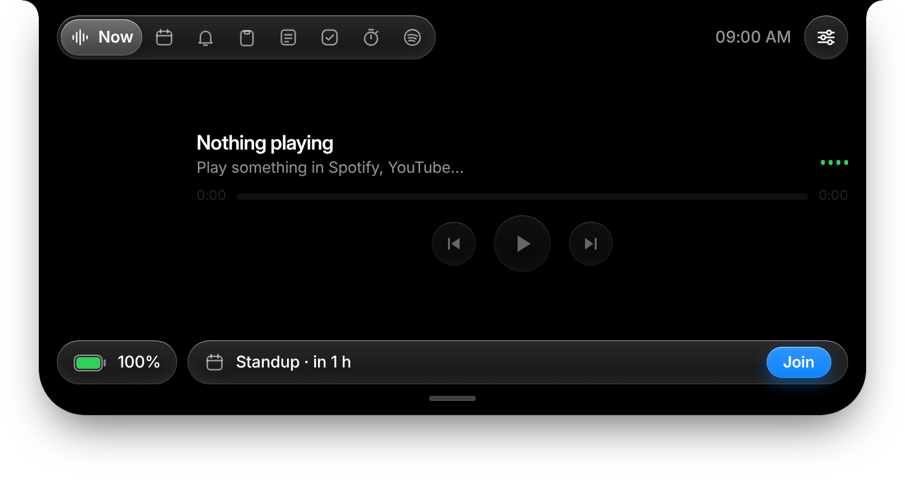
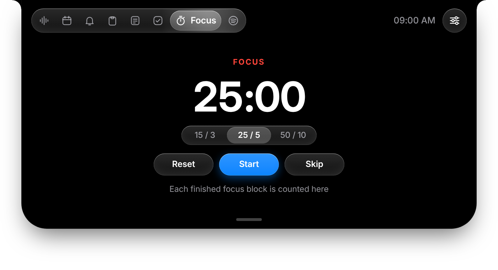
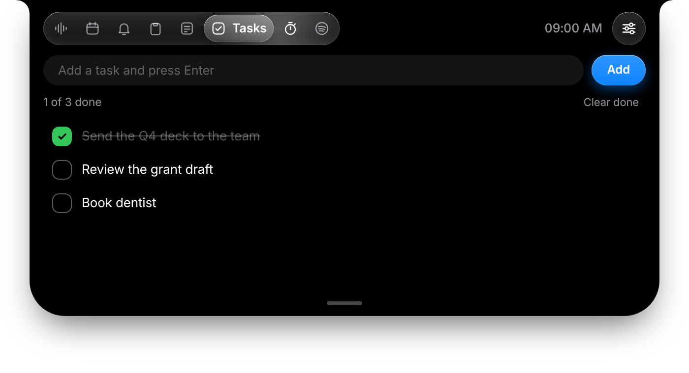
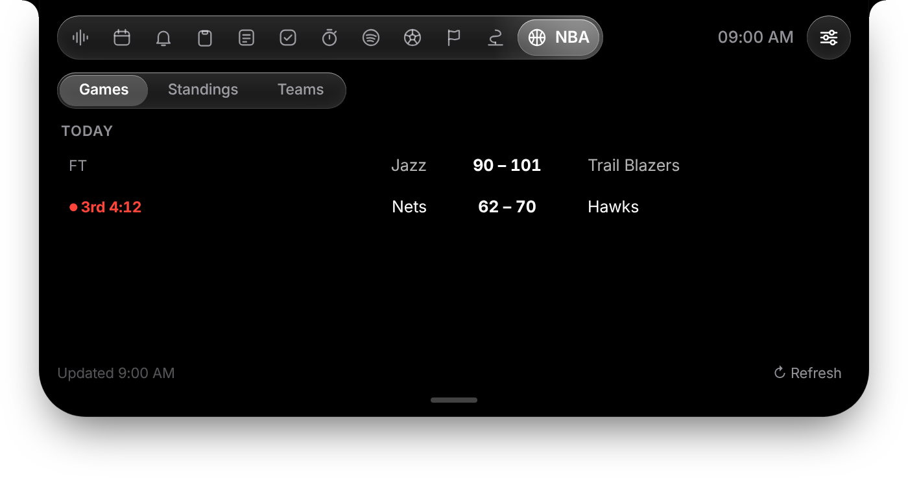

# Islet

**A Dynamic Island for Windows.** Islet lives in a notch at the top of your screen. It shows what's playing, your next meeting, your focus timer, your tasks, and Claude Code's permission prompts, and it expands when you hover or click it. It's free, open source, and everything it does stays on your PC.



## Download

**[⬇ Download Islet-Setup.exe](https://github.com/Invis55/islet/releases/latest/download/Islet-Setup.exe)** (Windows 10 or 11, 64-bit)

1. Run `Islet-Setup.exe` and follow the installer.
2. The first launch opens a short setup screen. Every step is optional.

Islet isn't code-signed yet, so Windows SmartScreen may say "unknown publisher". Choose **More info → Run anyway**. All releases are listed on the [Releases page](https://github.com/Invis55/islet/releases).

## What's in it

| Tab | What it does |
|---|---|
| **Now** | Now playing with controls (Windows media session, so it works with Spotify, YouTube and other players), battery, and your next meeting with a one-click **Join** |
| **Calendar** | Your next 7 days from a calendar link (`.ics`) |
| **Alerts** | Windows notifications, read-only, with an optional pop-up for each new one |
| **Clipboard** | Your last few copied texts and screenshots. Click to copy again, or drag into another app |
| **Notes** | A quick note that saves as you type |
| **Tasks** | A checklist for today: add, tick off, double-click to rename, clear what's done |
| **Focus** | A Pomodoro timer (15/3, 25/5 or 50/10). The island shows a pill while a block runs and alerts you at each break. Alerts that arrive during a work block are held and summarised at the break |
| **Spotify** | Playback controls, playlists and devices (needs your own Spotify developer app; see below) |

The island also shows **Claude Code** activity and lets you approve or deny its permission prompts.






## Optional: sports

Sports are **off by default**. Turn them on during setup, or in Settings → Features, to get:

- **Football:** fixtures, live scores and tables for the Premier League, La Liga, Serie A, Bundesliga, Ligue 1, Champions League, Europa League, MLS and Saudi Pro League, with alerts for kick-off, goals and full time.
- **F1:** the next race countdown, every session in your local time, standings, and the last result. **Live** shows a track map and flag status during a session. Live timing needs a paid OpenF1 sponsor account, so replays and the built-in demo are the free route.
- **NBA:** today's games with live scores, conference standings, and a team picker.



Sports data comes from unofficial public sources and is for personal use. Islet isn't affiliated with the NBA, F1, the football leagues, or any sports data provider. F1 is a trademark of Formula One Licensing B.V.

## Privacy

Everything Islet reads stays on your PC. Specifically:

- **Media:** the Windows media session, to show what's playing.
- **Notifications:** the Windows notification database, read-only, to fill the Alerts tab. Turn this off in Settings → Features.
- **Clipboard:** kept in Islet's own data folder. Screenshots are deleted when they leave the list and on each start. Anything a password manager marks as sensitive is never recorded. Turn it off in Settings.
- **Tasks and notes:** saved on your PC.

Islet only contacts the internet for things you add: a calendar link, a Spotify account, or sports you turn on. Your calendar link is stored locally, so treat it like a password.

**Claude Code:** Settings → Connect adds hook entries to `%USERPROFILE%\.claude\settings.json` and keeps your other settings. A backup is saved first. Disconnect removes the hooks again.

## Settings

- **Features:** turn Sports, the Focus timer, Tasks and notification reading on or off.
- **Appearance:** the notch when idle, music pill, F1 ambient light and calm lights.
- **Connections:** Spotify, OpenF1, calendar and Claude Code.
- **Alerts and General:** pop-ups, sounds, clipboard history, and start with Windows.

## Spotify (optional)

Spotify's developer rules require your own app. Create one at [developer.spotify.com/dashboard](https://developer.spotify.com/dashboard), add the redirect URI `http://127.0.0.1:47615/spotify/callback`, and paste the Client ID under Settings → Connections. Playback controls need Spotify Premium.

## Build from source

```
npm install
npm start        # run it
npm test         # the automated tests (no Windows or Electron needed)
npm run dist     # build dist/Islet-Setup.exe
```

Every push to `main` runs the tests on GitHub and publishes a new `Islet-Setup.exe` Release for the version in `package.json`.

To regenerate the screenshots after a UI change: `python scripts/make-screenshots.py`. They're rendered from the real interface with sample data.

## Known limits

- The Windows-only parts (`media.ps1`, `notifications.ps1` and `hook.ps1`) have been tested with automated tests and in a sandbox, but not yet on a real Windows PC. Please report anything that doesn't work.
- Islet's sports and Spotify features depend on public services that can change without notice.
- The app shows the primary monitor only.
- Dragging a screenshot out of the Clipboard tab works on Windows only.

## Licence

MIT. See [LICENSE](LICENSE). Islet is provided as is, with no warranty.
